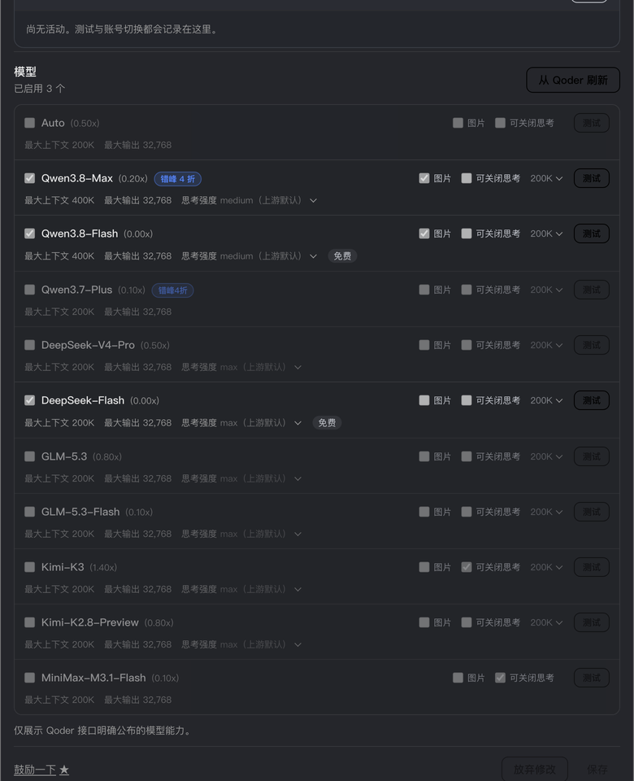

<p align="center">
  
</p>

<h1 align="center">dsh-connect-qoder</h1>

<p align="center"><b>Connect Qoder (Lingma CN / international) models to DeepSeek Harness, with an account pool, daily check-in, credit readouts and model management.</b></p>

<p align="center">
  <a href="README.md">中文</a> ·
  <a href="#installation">Installation</a> ·
  <a href="#how-it-works">How it works</a> ·
  <a href="#configuration">Configuration</a> ·
  <a href="#account-pool">Account pool</a> ·
  <a href="CHANGELOG.md">Changelog</a> ·
  <a href="https://github.com/dingminhua/dsh-connect-qoder/issues">Issues</a>
</p>

<p align="center">
  <a href="https://www.npmjs.com/package/%40dmh2002%2Fdsh-connect-qoder"></a>
  <a href="https://www.npmjs.com/package/%40dmh2002%2Fdsh-connect-qoder"></a>
  <a href="https://github.com/dingminhua/dsh-connect-qoder/actions/workflows/ci.yml"></a>
  <a href="LICENSE"></a>
  <a href="https://github.com/dingminhua/dsh-connect-qoder/stargazers"></a>
</p>

A standalone [DeepSeek Harness (DSH)](https://github.com/deepseek-ai/deepseek-harness) bundle plugin. It connects your Qoder account's models to the DSH model picker, with an account pool, daily check-in, credit readouts and model management. **The CN and international editions are two parallel providers (`qoder` / `qoder-global`) that can be used at the same time**; the plugin's settings card separates them with tabs.

> Qoder does not expose an OpenAI-compatible endpoint (its official SDK is only an agent launcher), so this plugin talks to Qoder's cosy gateway directly, implementing a minimal client for the protocol. No Qoder desktop sign-in is needed — just a PAT (Personal Access Token).

## Features

- **Two parallel providers (CN + international)** — the CN edition registers as the `qoder` provider (`gateway.qoder.com.cn`); the international edition registers as `qoder-global` (`api1.qoder.sh`). **Regions with a PAT configured show their models in the DSH model picker**: with a PAT for both regions you get two groups that can be used simultaneously and independently per session. **A region without a PAT lists no models** (no request could succeed, so listing them would only invite failures); configure a PAT and hit "Refresh models" to make them appear — the provider itself stays registered, because its settings card is the configuration entry point. Model names embed the upstream credit multiplier (e.g. `Qwen3.8-Flash · x0.00`), matching Qoder's own model menu.

  
- **Settings card tabs** — the card top has "CN / Global" tabs, each with its own PAT, account pool, model management and credits; catalogs, selections and state stay fully isolated per tab.
- **Accounts / Models / Diagnostics sections** — under each region tab the body is split into three sections. *Accounts* holds the pool, the credit-readout switches and every notice about the credential (each lands on the click); *Models* holds the checkboxes, context tiers, reasoning strengths and per-model tests (a draft until you press Save) — the two commit differently, so splitting them puts the save button next to what it saves. **Switching sections never refetches and never drops an unsaved draft** (inactive sections stay mounted). *Diagnostics* is a read-only fact table: region, **upstream domain** (the same single fact the real requests use), serving account, credential source, when credits were read, catalog size, enabled count, pool switch, and upstream's own last error **verbatim** — it exists to be quoted into a bug report, so it deliberately holds no control that could change a setting.
- **Per-region kill switch** — each tab has a checkbox on the right (both checked by default). **Unchecking removes that provider from the DSH model picker entirely** (not just hiding the tab): both its adapter route and its "Settings → Models" directory entry are removed. PAT, credits, and selections are **all kept**; re-checking restores everything. Note: a session that had already selected a model of the disabled provider will get `NO_ADAPTER` on its next call.
- **Model management** — refresh the full model catalog from upstream and toggle each model on or off; each row shows the multiplier (`(0.50x)`), context/output limits, thinking-effort tiers and a free marker, plus "Image" and "Off-able thinking" switches, a context-tier selector and a "Test" button on the right. Selections are written to local config and sync to the model picker immediately. **The list is as tall as the catalog — it caps no height and grows no inner scrollbar**: its whole job is "let me see every model and tick it", so showing seven rows of twenty and hiding the rest behind a second scrollbar (the panel already scrolls) would turn "does this model exist?" into something you must first discover, then drag. **Upstream's `auto` is not listed**: it is the region's default *router*, resolved by the gateway into some model at request time, so its price and context window are decided by someone else — it is not a model, and does not deserve a row you can tick.

  
- **Promotion badge** — upstream ships the promotion rule inside the model catalog itself (`promotion`: label, window, time zone), so each row paints a small capsule next to the model name, e.g. `Off-Peak 60% off`. **The label is upstream's own text** (Chinese UI reads `badge.zh`, English UI `badge.en`); the plugin neither translates nor rewrites it. Hover shows upstream's description, the window and time zone, and the campaign link as plain text. Whether it paints is decided **at render time**: when upstream declares a wall-clock window (midnight-crossing supported, evaluated in upstream's own time zone) that window alone decides, and only a rule without a window falls back to upstream's `active` flag — so a catalog fetched at night cannot freeze the badge until the next morning, and a process started in the morning still shows it that night; models without a promotion field paint nothing. The same badge also renders in the host's **model picker** (`conversation.input.model.label` slot, issue #12) — that is where the choice actually gets made — sharing one evaluation, one copy and one stylesheet with the card. Evidence and rules: [docs/PROMO_BADGE.md](docs/PROMO_BADGE.md).

  
- **Per-model availability probe** — every model row has a "Test" button that goes straight to upstream: rate-limited (429) → "Rate limited", invalid credential → "Invalid credential", content-policy rejection → "Blocked by content policy", quota exhausted → "Quota exhausted", and other upstream transient failures are classified honestly. Probes run in the background, **credentials never reach the page**; results are not written into settings and do not change your saved selections. **Probes are real requests** (they consume a small amount of upstream credit), so they are per-model and manual only — there is no batch "test all checked" button.
- **Daily check-in** — Qoder runs an official daily check-in campaign (individual users claim 100 credits a day, valid for 30 days). The account pool has a "Check in all accounts" action: it claims per account, treats an already-claimed day as idempotent success (no double claim, not a failure), and refreshes credits afterwards. Both regions are wired up (the international edition needs the device-risk identity that the local Qoder client ships; when it cannot be obtained the plugin reports that honestly instead of pretending "no campaign today").
- **Campaigns (read-only)** — the card shows a "Campaigns" list inside the region scope, below the credit readout, with every campaign the upstream currently serves: the daily 100-Credits check-in row (with its amount and a Claimable / Claimed state) plus the `VIEW_DETAILS` banners such as "1024 | Creativity Rally" or "double first-month subscription credits". **Titles and descriptions come verbatim from the upstream** (the interface language picks `zh` / `en`, falling back to the other side); "View details" is a real link (the upstream `detailUrl`, falling back to the campaign landing page). It is **read-only** — no check-in, no account writes. When the upstream sends nothing it shows "no active campaigns", and when the read fails it states the reason instead of pretending there are none. Earlier versions only read the small slice of campaigns used for check-in and skipped the banner rows entirely (user report 2026-10-25); the whole feed is now read.
- **Credits (read-only)** — the pool table shows each account's remaining credits and its nearest credit-package expiry (from Qoder's `sash/api/v2/me/usage`, queried with the `jt-` jobToken); packages expiring within three days are highlighted. The query is **read-only** and costs no credits; when it fails (credential rejected / upstream silent) the card says why and offers a way out instead of showing a blank.
- **Secure loopback shim** — one random port + in-process random secret per region, so the real Qoder PAT **never reaches pi-ai**: pi-ai only talks to the local shim, which performs upstream requests with cosy sessions (jobTokens).
- **Multi-account pool (PAT)** — a per-region local vault `$DSH_HOME/.qoder-accounts.<region>.json` (0600) merges the settings PAT, environment variable, and vault accounts into one de-duplicated list; the card can add (paste a `pt-…`, validated via a `JobToken` exchange that returns the display name; you may also set your own label), rename accounts, and can pin a specific account to serve (`regions.<region>.accountId`, empty = automatic by settings → env → vault). **Taking an account out of rotation and deleting it are different actions**: untick it in the pool table and save (the PAT stays put, and you can tick it back at any time), or press the row's **Delete** button — a second confirmation erases the stored PAT for good and drops the account from the pool and the region selection. A PAT coming from the app's settings or the environment is not the plugin's to delete, so those rows get no delete button.
- **Probe-ranked selection and automatic failover** — "Test all accounts" sends a real request per pool member (the target model defaults to an automatically picked multiplier-0 free model in that region) and persists results to `$DSH_HOME/.qoder-pool.<region>.json`; with the pool enabled, the chat stream picks the top-ranked usable account before the first byte (`rankPool`: usability → expiring credits first → soonest expiry → highest credits → id) and retries the next usable accounts on failure, writing failures back as `live-request` probes. With the switch off, the plugin neither picks nor swaps for you — it just reports the error. **An upstream-asserted quota exhaustion is always surfaced**: the moment a business code in the quota family (110 daily count / 113 quota / 118 credits spent, …) comes back on the chat path, the region's card shows an "upstream reported quota exhausted" notice (last-seen time + business code; the hover carries the redacted upstream text) — independent of the pool switch, because per-account `out-of-credit` detail only lives in the pool view, and with the pool off this notice is the **only** place that failure ever shows (the gap left when the 0.7.x "daily quota suspected exhausted" pill was removed). Rate limiting (a short-window HTTP 429) is **never** marked as exhaustion — that is a cooldown, not an empty tank.
- **Account transfer (import / export)** — export a region's vault accounts to a transfer file, preview it, and import by index; cross-region domains (`qoder.com.cn` / `qoder.sh`) are positively matched and non-matching records are counted as `skipped`.
- **Thinking effort and context budgets** — upstream declares `thinking_config.efforts` per model, and the card lists **only the tiers that really exist** (Qwen-family `low/medium/xhigh`, DeepSeek/GLM-family `low/high/max`); your choice is saved and sent with every request using the same fields the Qoder client uses (dual-written at the top level and in `parameters`). Context tiers likewise come only from the model's declared `context_config`; nothing is invented when a model declares none.
- **Honest model capabilities** — upstream's `is_vl` is a **platform**-level image claim, not a per-model capability, and it reads `true` for almost every model, so the plugin **never uses it as the answer**. Image input is pre-checked only from a table keyed by exact model id; anything unverified (including brand-new models) stays unchecked, and the switch tooltip explains why. The table is backed by **vendor docs plus on-device measurement**: on 2026-10-29 every one of the 14 models across both regions' catalogs was sent an image of the digit `7` and asked which digit it was — **all of them read it**, so the current catalog contains no text-only model (the earlier by-name assumption that "code" models must be text-only was falsified). "Off-able thinking" is offered only where upstream explicitly declares it and the model is not in the known-rejection set. Fewer options beats an option that fails when pressed.
- **Cache hits reported truthfully** — upstream's `usage` carries `prompt_tokens_details.cached_tokens`, and the plugin passes it all the way through to the host, so the GUI's per-round "cache hit" figure is a real ratio. (Before the fix it read 0% forever: the field was dropped on the normalization path, and that 0% was an untrustworthy reading rather than evidence that caching did nothing.) **The hit count is a subset of `prompt_tokens`, not an addition** — so it is never folded into the totals (that would count the cached prefix twice). When upstream does not report the field it is omitted, never replaced with 0.
- **Composer credits readout (position is a choice)** — the session input shows `QD CN` / `QD AI` with the serving account's balance (e.g. `QD CN · 92`); clicking it opens a per-account balance table where a row click switches accounts. Gated by the per-region "show credits in the composer" switch (default on, opt-out). **The readout can sit in either of two places** (a per-region dropdown in the card, default unchanged): **the composer toolbar** (`conversation.input.left`, closer and easier to glance at) or **below the composer** (`conversation.composer.dock`, the ambient row where the shell renders its own round / tok-per-sec / token / cache-hit stats). The reason it is a choice: the composer toolbar is a **shared list slot**, so another plugin parking something there can crowd the readout out of sight — switch to "below the composer" if that happens (mirrors workbuddy issue #62). 

  
- **CLI diagnostics** — `dsh-connect-qoder doctor|status|logout [--json] [--region cn|global]`: `doctor` reports PAT source, cosy fingerprint derivation, pi-ai generation, host heartbeat liveness, and vault account counts; `status` reports credential source, upstream reachability, and remaining credits; `logout` clears a region's vault accounts and pool measurements. No browser needed.

## How it works

```text
DSH PiAiAdapter (one set per provider)
  -> secure loopback shim (random port + in-process secret per region)
  -> QoderUpstreamClient (minimal cosy-protocol client)
  -> CN      https://gateway.qoder.com.cn/algo/api/v2/...
  -> Global  https://api1.qoder.sh/algo/api/v2/...
  -> Qoder SSE (OpenAI-shaped deltas)
  -> DSH executes local tools and returns results
```

The CN and international editions each own a full runtime stack — upstream client, model catalog, loopback shim, adapter — isolated by region configuration (gateway / openapi / catalog paths), so **models from both regions can be available at the same time and used by different sessions**.

Credentials are PATs (settings card `regions.<region>.pat`, or environment variables — see [Configuration](#configuration)); the settings value wins. Sessions lazily exchange a **jobToken** on demand: the PAT is used once in that exchange, and every subsequent request carries a cosy bearer (custom Base64 payload + MD5 signature) plus "machine fingerprint" session headers. **The PAT never reaches pi-ai and never leaves the process except in that one local exchange; this plugin neither reads nor writes Qoder desktop sign-in files.**

Encoding and signing details (custom alphabet, `n/3` rearrangement, `cosy&<SECRET>&<date>` signature, RSA/AES session wrapping) are documented at the top of `src/cosy.ts`; the error taxonomy (content policy / rate limit / quota exhausted / transient) and how it maps onto DSH retry semantics live in `src/upstream.ts`.

## Installation

### From a published package (recommended)

```bash
dsh plugin --profile desktop add @dmh2002/dsh-connect-qoder   # Desktop
dsh plugin --profile web add @dmh2002/dsh-connect-qoder       # Web
```

Then **restart that profile's DSH process** (the host half of a bundle loads at startup). You can also search for `dsh-connect-qoder` in DSH's "Plugin market / Bundles" and install it in one click.

> **Does `dsh` fail with `Cannot find module .../DSH NEXT.app/...`?** That is a stale shim left over from the host's app rename: the app directory moved from `DSH NEXT.app` to `DeepSeek Harness.app`, and `~/.local/bin/dsh` still points at the removed path. Repoint the shim at the CLI entry the new host ships:
>
> ```bash
> exec "/Applications/DeepSeek Harness.app/Contents/Resources/runtime/cli/bin/dsh" "$@"
> ```
>
> That entry runs `dsh/lib/bin.js` inside `app.asar` via `ELECTRON_RUN_AS_NODE`; the profile is still chosen with `--profile`.

> The npm package name carries the `@dmh2002/` scope. The plugin's **configuration identity inside DSH does not** — the settings namespace, the `/plugins/dsh-connect-qoder/…` routes and the CLI program name all stay `dsh-connect-qoder`, so anyone upgrading from 0.2.0 keeps their saved configuration with no need to re-enter PATs. But the **browser bundle's module id and the settings card's slot keys are both keyed by the scoped package name** (`plugins.bundle.config` takes the bare package name, `plugins.row.config` takes `<package name>#<row id>`, and the row id stays unscoped); these are injected from `package.json` at build time, so a rename cannot leave them behind.

### From source (development)

```bash
git clone https://github.com/dingminhua/dsh-connect-qoder.git
cd dsh-connect-qoder
pnpm install
pnpm run check        # typecheck + test + build must all pass first
```

Install the repository directory with `link:` so edits take effect after a DSH restart (without reinstalling the dependency tree):

```bash
dsh plugin --profile desktop add /Users/dmh2002/DshProject/dsh-connect-qoder
```

### Verify the installation

- "Settings → Plugins" should show the dsh-connect-qoder card with its CN / Global tabs.
- `pnpm exec dsh-connect-qoder doctor`, run inside that profile directory, should print both regions' PAT status and fingerprint derivation.
- After configuring a PAT, "Refresh from Qoder" should fetch the region's real catalog; the model picker shows `Qoder` / `Qoder Global` groups.

## Configuration

### PAT (Personal Access Token)

Create a PAT (`pt-…`) in your Qoder account settings. Two ways to provide it — **the settings card wins over the environment variable**:

| Region | Where to issue it | Setting | Environment variable |
| --- | --- | --- | --- |
| CN (qoder.com.cn) | Console → Settings → API Tokens | Card "CN" tab → Add PAT | `QODERCN_PERSONAL_ACCESS_TOKEN` |
| Global (qoder.sh) | Console → Settings → Personal Access Tokens | Card "Global" tab → Add PAT | `QODER_PERSONAL_ACCESS_TOKEN` |

- The PAT is stored only in the local plugin configuration (`regions.<region>.pat`); it is never uploaded and never enters any network request.
- A region without a PAT lists no models; the `doctor` command points out which region is missing one.
- **Step-by-step walkthrough in [`docs/PAT.md`](docs/PAT.md)** (issuing, verification, precedence, troubleshooting).

### Region enable/disable

The checkbox on each tab controls whether that region participates in the model picker (opt-out: **only an explicit uncheck disables it**). Disabling only removes the route and the directory entries; configuration is kept.

### Multi-account pool and credential sources

Besides the settings PAT and the environment variable, each region has a local vault (`$DSH_HOME/.qoder-accounts.<region>.json`, mode 0600) that stores multiple PAT accounts. The three sources are merged de-duplicated by **settings → env → vault** (a PAT appearing in two sources is listed once, under the higher-priority source).

- The card can add (paste a `pt-…`, validated via a `JobToken` exchange that returns the display name; you may also set your own label) and rename vault accounts, and can pin a specific account to serve (`regions.<region>.accountId`, empty = automatic). Deleting a vault account is the pool table's per-row **Delete** button (which asks once before it acts); unticking and saving only takes it out of rotation.
- The selected credential is used only for the session's jobToken exchange and subsequent cosy requests — it never reaches pi-ai or the page.
- `logout [--region cn|global]` clears that region's vault accounts and pool measurements (`.qoder-accounts.<region>.json` and `.qoder-pool.<region>.json`).
- Membership, the batch actions, and the failover rules are covered in the [Account pool](#account-pool) section.

## Account pool

One machine often holds several Qoder accounts (several PATs). The **account pool** collapses that into single clicks: check accounts into the pool, then "Check in all accounts" or "Test all accounts"; switch on **Enable account pool** and the plugin automatically fails over to another account when a request fails upstream.

**Each region (CN / international) has its own pool**: members, target model, credits and check-in state never cross over — the accounts belong to different providers anyway. **Both regions have daily check-in**: the international campaign is only served to requests carrying device-risk headers, which the plugin obtains from the device-identity component shipped by the local Qoder client; if it cannot be read, the plugin reports that honestly instead of silently degrading to "no campaign today".

### Automatic failover (enabled together with the pool)

- **Ranking decides who serves**: with the pool on, **every request** goes to the top-ranked usable account, so "currently serving" may not be the account you pinned.
- **Failures walk down the list**: when a request fails upstream, the plugin retries the next usable accounts **in order**, until one takes over or all are exhausted — only then is the error surfaced.
- **What triggers a switch**: 429 rate limits, exhausted quota, rejected credentials (401/403), 5xx gateway/network failures — those are per-account states.
- **What does not**: an invalid request (HTTP 400) — the same body fails identically for everyone, so retrying only makes you wait; and a stream that has already started is never replayed (bytes are on the wire).
- **Known-bad accounts are skipped**: members inside a rate-limit cooldown or with a credential the upstream rejected do not participate. **Never-tested accounts count as usable by default** — a freshly added account should not be excluded because nobody pressed "Test" yet.
- **Your manual choice is never rewritten**: the pool overrides routing at runtime and never writes back your saved selection; turning the switch off restores your pinned account immediately.
- **Failures are remembered**: a failed request is stored as that account's measurement (including the reset time the upstream states), so the next request starts from a usable account instead of hitting the same wall again.
- **A switch is announced**: the swap is a decision the plugin made on your behalf, so it says so — the answer opens with a blockquote notice such as `> [dsh-connect-qoder] "450702134816" was rate-limited; another pool account answered instead.`. The notice names the **account that failed** (your selection), never the one that took over; consecutive swaps produce a single notice naming the failure immediately before the last hop. When nothing was swapped, nothing is written.

### What the switch actually controls

**It controls "should the plugin decide", not "are you allowed to act".**

| | Pool **on** | Pool **off** |
| --- | --- | --- |
| Who serves | chosen **automatically** by ranking (usable → expiring package → soonest expiry → most credits → id) | the account **you** pick under "Which account to use" in the settings area |
| Request fails | retries the next usable account **automatically** | no switch; the error is reported as-is |
| Check in all / Test all | available | **still available** |
| Target test model | editable | **still editable** |

The last two rows are deliberate: checking in and testing are **manual actions** on the members you selected — a different question from whether the plugin routes automatically.

**The one hard rule**: with zero members checked, batch actions refuse outright. An empty pool never degrades into "then run it on all accounts" — that would be the one reading that spends credits you did not authorize.

### The retry budget is configurable (`regions.<region>.retry`)

The host has an in-place retry loop: when a request fails but is worth one more attempt, it waits and sends it again. The wait ladder is declared by the plugin and executed by the host; by default it follows the host, so leaving it unset keeps your behaviour exactly as it is today.

Qoder occasionally answers with `RESOURCE_LIMIT` (business code `10605`) and **states how long to wait**. The plugin now writes that value into the failure text it hands the host (of the form `[upstream retry-after 5s]`), so you can see that upstream only asked for five seconds instead of just "upstream returned a 4xx".

To change the budget, set three numbers (per region):

```yaml
regions:
  cn:
    retry:
      maxRetries: 4        # attempts (0 = follow the host default)
      initialDelayMs: 5000 # first backoff in ms (0 = follow the host default)
      maxDelayMs: 30000    # backoff ceiling in ms (0 = follow the host default)
```

`5000 -> 30000` covers both common upstream shapes: a transient throttle (5 s) and a `queueType:p2` queue (about 30 s). **Three zeros mean "follow the host default"**, so leaving them out is equivalent to not configuring this at all.

> Previously this was whatever the host picked; changing it meant editing the build artifact inside `node_modules` — and that silently reverts on upgrade.

### Ranking rules (who serves when the pool is on)

1. **Usable first** — accounts measured unusable (rate-limit cooldown, rejected credential) go to the back and do not participate;
2. **Most credits first** — but only with a **fresh reading** (from card polling, a batch test, or a save; valid for 10 minutes). The request path never calls upstream just to rank, otherwise one page of chat becomes N extra requests;
3. **Soonest-expiring credit package** — packages expiring within 3 days get spent before they lapse;
4. Finally account id, so the order is a total, reproducible sequence.

### The two batch actions

- **Check in all accounts** — claims the daily campaign per account. **Status is read before claiming**, so an already-claimed day is marked "checked in" without a write request (idempotent, no double claim); a failure on one account marks that row and **never aborts the batch**. Claiming changes balances, so the region's usage cache is invalidated when the batch ends.
- **Test all accounts** — one real request per member, answering "can this account use this model right now". The target model defaults to "automatic": a multiplier-0 free model in that region (largest context wins ties). You may pin one — but **testing stays disabled until a free model appears**, so credits are never spent without you knowing. Tests share the per-model probe, so they **have a real cost**.

Neither batch action **locks the interface**: the button itself turns into "Checking in… / Testing…", and as each account finishes its row is updated and its line lands in the activity log **individually**, stamped with that account's own completion time rather than the second the batch ended. Everything else stays usable. Only **saving the config** and **deleting an account** put a veil up — the former is writing to disk, the latter is irreversible.

How the settings card is laid out: two **independent provider cards** sit at the top (CN / international), each with its own border, background and switch on the right, and the selected one carries the brand-coloured outline — **one card is one unit**: click the name to switch tabs, click the switch to enable that provider. Below them come the two credit rows ("show credits in the composer" and "position"; the whole row is clickable and the description sits under the title), then the account pool, then model management. Those two rows decide whether the credit readout appears and where it sits — they take effect **immediately, with no save needed**.

There is **no automatic** check-in: claiming collects a real reward, so it only happens when you press the button.

## CLI diagnostics

Run **inside the profile directory that has the plugin installed** (recommended, no global install):

```bash
cd ~/.dsh/profiles/desktop
pnpm exec dsh-connect-qoder doctor    # PAT source + cosy fingerprint + pi-ai generation + heartbeat + vault counts (offline)
pnpm exec dsh-connect-qoder status    # per region: credential source + upstream model-list reachability + remaining credits (needs PAT)
pnpm exec dsh-connect-qoder logout --region cn   # clear that region's vault accounts and pool measurements
pnpm exec dsh-connect-qoder doctor --json        # machine-readable output
```

`status` really exchanges a jobToken and fetches the model catalog (then reads usage once, read-only), so it needs that region's environment or vault PAT; `doctor` is fully offline.

> **Two things measured on a real machine**:
> 1. **Do not use a bare path like `node node_modules/dsh-connect-qoder/lib/bin.js`** — as of 0.3.0 the package name is scoped, so the symlink lives at `node_modules/@dmh2002/dsh-connect-qoder`; the old path just gives `MODULE_NOT_FOUND` (a missing **entry file**, not a missing peer).
> 2. The CLI depends on the host-provided peers (`@deepseek-ai/dsh-atomic-write` / `dsh-home-paths`). Locally, pnpm installs them into the profile's dependency tree, and both `pnpm exec` and an npm-installed tarball work. But that **depends on your pnpm version and `auto-install-peers` setting** — if you see `Cannot find package '@deepseek-ai/dsh-atomic-write'`, that layer did not get installed. Provider registration, the settings card and chat are **unaffected** (they run inside the host, which resolves those names). The sibling workbuddy's issue #47 is the same shape; its fix (host-first, fall back to a built-in copy on demand) applies here too and has not been ported yet.

## Platform support

| Platform | Status |
| --- | --- |
| macOS | ✅ Verified (development and CI) |
| Windows | ✅ CI tests pass (upstream uses standard fetch; no platform-specific paths) |
| Linux | ✅ CI tests pass |

## Supported host line

| Host | Peer range |
| --- | --- |
| DSH (`@deepseek-ai/*`) | `>=0.1.7-rc.1 <0.2.0-0 \|\| >=0.2.0-rc.1 <0.3.0-0 \|\| >=0.2.1-rc.1 <0.3.0-0` |
| `@earendil-works/pi-ai` | `>=0.85.0 <0.88.0 \|\| >=1.0.0 <2.0.0` |
| Node.js | `^22.19.0 \|\| >=24.0.0` |

> Enforced by `tests/dsh-line.spec.ts`. DSH only ships prereleases, and node-semver admits a prerelease **only** when some comparator in the range names that exact `major.minor.patch` tuple *and* carries a prerelease tag — so every new line needs its own branch. Writing `>=0.1.7-rc.1 <0.3.0-0` silently excludes the whole `0.2.0-rc.*` line; likewise `>=0.2.0-rc.1` does **not** cover `0.2.1-rc.1` (which Desktop 0.2.1-rc.1 ships). The upper bound must keep `-0` (`<0.3.0` blocks nothing).
>
> **Two semver readings coexist** (corrected by measurement in 1.1.2): **npm / pnpm installation** uses node-semver's **standard** reading, so a new patch line's rc (`0.2.2-rc.1`) really does still need a hand-added branch — that is what `UNGATED_PRERELEASES` tracks. But the **host's plugin-compatibility gate does not use the standard reading**: `dsh-app-boot` calls `semver.satisfies(v, range, { includePrerelease: true })`, under which `>=0.2.1-rc.1 <0.3.0-0` alone covers the **whole `0.2.x` line** (`0.2.2-rc.1`, `0.2.9` all pass) while `0.3.0-rc.1` is still blocked by the ceiling. 1.1.0/1.1.1 claimed "no static range can cover any `0.2.x` prerelease" — true for npm, false for the host gate, now corrected.
>
> **pi-ai gets its own row** because it changed major: Desktop 0.2.1-rc.1 moved pi-ai from 0.85 to 1.x, and the two generations consume different context shapes (1.x normalizes in its Models layer). The declaration and the runtime detection must agree — otherwise you get the silent tool-loss bug fixed in 1.1.0. See [`docs/DSH-0.2.1-RC1-FOLLOWUP.md`](docs/DSH-0.2.1-RC1-FOLLOWUP.md).

### Current host baseline: 0.2.1-rc.3 (measured 2026-10-24)

The host moved to `0.2.1-rc.3` (`DeepSeek Harness.app`, nightly channel; every `@deepseek-ai/dsh-*` package inside `app.asar` is `0.2.1-rc.3`, bundled pi-ai is `1.1.0`). **This plugin needs no runtime code change.** The reasoning, item by item:

| Check | Result |
| --- | --- |
| Host packages the plugin depends on (`dsh-llm` / `dsh-llm-pi-ai` / `dsh-settings` / `dsh-atomic-write` / `dsh-attachment` / `dsh-host-webserver` / `dsh-home-paths` / `dsh-client-ui-slots` / `dsh-client-ui-settings` / `dsh-client-ui-settings-plugins` / `dsh-client-ui-renderer` / `dsh-client-locale`) | Byte-identical to rc.2 (only the `package.json` version differs) |
| rc.3's client-side changes | All **additive**: view-tab pinning plus the new `conversation.session.header.views.actions` slot, draft adoption gaining `whenDraftExists` (`replace` / `append` / `keep`), primitives' `Tooltip` gaining `left` and automatic flipping, `Menu` gaining `current` and `minWidthFromAnchor`, two new icons. **No** slot or owner prop the plugin uses was changed |
| Peer range | `>=0.2.1-rc.1 <0.3.0-0` admits `0.2.1-rc.3` under both the npm-standard reading and the host gate's `includePrerelease: true` reading (the latter covers the whole `0.2.x` line) |
| Actual load on rc.3 | The `Config` directory shows `include:dsh-connect-qoder` with status `schema`; the client slot `conversation.input.model.label` is occupied by `dsh-connect-qoder-client` (priority `-1`), and `conversation.input.left` carries `dsh-connect-qoder-composer-credits` — `dsh plugin list` raises no compatibility warning for this plugin |
| Regression | `pnpm run typecheck` and `pnpm test` (948 passed / 8 skipped) are green |

> The **environment** change that came with rc.3 (not a plugin problem): the host app directory was renamed from `DSH NEXT.app` to `DeepSeek Harness.app`, which breaks a `dsh` shim still pointing at the old path — see the note under [Installation](#installation).

## Security notes

- The PAT is stored only in the local plugin configuration (or an environment variable) and **never enters any network request**; external calls always use cosy session tokens (jobToken) plus machine-fingerprint headers.
- The local shim is a random-port loopback service with an in-process secret, verifying Host / Origin / Content-Type, with a 64 MB request-body cap.
- The plugin only reads PATs you explicitly provide; it **never reads or modifies** Qoder desktop sign-in/credential files.
- Diagnostic output (`doctor` / `status` and card probes) is redacted and never prints token-like strings.

## Market listing and presentation

The plugin declares an installable `dsh.bundle` manifest (`dsh.bundle.patch: ./cordis.patch.yml`), so `dsh plugin add` works. Community markets usually sync entries from the [Awesome DSH Plugin](https://github.com/awesome-dsh-plugin/awesome-dsh-plugin) registry; the submission draft lives in [`awesome-dsh-plugin-submission/dingminhua__dsh-connect-qoder.yml`](awesome-dsh-plugin-submission/dingminhua__dsh-connect-qoder.yml).

**Registry rules** (per [contributing.md](https://github.com/awesome-dsh-plugin/awesome-dsh-plugin/blob/main/contributing.md)):

- One YAML per plugin: `data/plugins/<owner>__<repo>.yml`, with `url` (exactly the repository URL), `name` (`owner/repo`), `category` (a valid value; `model` here), `description.en` (required, ends with a period) / `description.zh` (optional); quote any description containing `: `.
- The repository must declare the `dsh.bundle` manifest, carry the `dsh-plugin` topic, be at least a day old and actively maintained; descriptions must be factual and free of marketing language — they are checked against the code.
- The registry's two READMEs are generated, never hand-edited; after changing a YAML, run `npm ci` + `node scripts/generate-readme.mjs` in that repository.
- A PR carries at most 3 entries; only touch your own.

Market screenshots and GitHub README badges are two different mechanisms:

- **Market screenshots** are declared, under the current convention, by **`screenshots.json` in this plugin's own repository root** (see [screenshots.json](screenshots.json)); the registry's `data/screenshots.json` is a legacy fallback and takes no new keys.
- **GitHub badges** come from the Shields image links at the top of this README. **Market icons / placeholders** follow each storefront's own display rules — they are neither an npm field nor a README badge.

## Known limitations

- This depends on Qoder's cosy gateway and `sash` endpoints (**not an official public API**); upstream changes may require plugin changes. The protocol behavior is referenced from [Zhengyuuuui/qoder2api](https://github.com/Zhengyuuuui/qoder2api) and independently implemented here — no source is copied.
- **Daily check-in** is Qoder's operational campaign for **individual** accounts (organization accounts do not participate); the rules and amounts are the vendor's to change. The international campaign requires the device identity that the local Qoder client provides, so **on a machine without the Qoder desktop client, international check-in is unavailable** (the plugin says so explicitly rather than degrading silently).
- Image input and "off-able thinking" are offered per a **verified** list: models outside it are never pre-checked, so one that actually works may need a manual check from you. **The image switch is a whitelist** — once you have saved a selection, un-checked models stay off; un-checking everything and saving keeps them off instead of letting the defaults switch them back on.
- Per-model and batch tests **send real requests** and consume a little upstream credit. There is no "test all checked" button, and batch actions only touch accounts you explicitly checked into the pool.
- **The standalone CLI depends on host-provided peers** (`@deepseek-ai/dsh-atomic-write` / `dsh-home-paths`). Locally pnpm installs them alongside the package and `pnpm exec dsh-connect-qoder …` works; if your pnpm configuration does not, the CLI reports `Cannot find package …`. Provider registration, the settings card and chat are unaffected — they run inside the host, which resolves those names. The workbuddy fix (host-first, fall back to a built-in copy) applies here and has not been ported yet.

## Disclaimer

- This project is **for personal learning and research only**; it drives only your own Qoder account on your own machine. Do not use it commercially or beyond reasonable personal use.
- Users must comply with the Qoder / Lingma terms of service; any consequence of using this project (including account restrictions, quota wipe or service interruption) is borne by the user.
- The author accepts no liability for any direct or indirect loss caused by using or misusing this project.
- This project is unaffiliated with Alibaba, Lingma, Qoder, or DeepSeek and is not endorsed or authorized by them; names appear only to describe compatibility, and their trademarks belong to their respective owners.

## Acknowledgements

This project builds on other people's public work — see [THIRD_PARTY_NOTICES.md](THIRD_PARTY_NOTICES.md):

- [**Zhengyuuuui/qoder2api**](https://github.com/Zhengyuuuui/qoder2api): reference implementation of the cosy protocol wire behavior (encoding, signing, sessions, fingerprints, jobToken, SSE shapes, error classification). This project **independently re-implements** that behavior in TypeScript and copies no source code; the repository ships no standalone LICENSE and its README points at `wangtufly/QCCG` (GPL-3.0).
- [**L0NE-6/Qoder-Daily**](https://github.com/L0NE-6/Qoder-Daily) (MIT): reference for the daily check-in protocol (the `campaigns` / `claim` shapes, idempotency, and the international device-risk idea). This project independently implements it from that documentation plus local measurement, copying no source.
- [**dingminhua/dsh-connect-workbuddy**](https://github.com/dingminhua/dsh-connect-workbuddy) (MIT): baseline for the plugin engineering layout, card interaction model, loopback shim pattern, and npm publishing workflow.
- [**dingminhua/dsh-connect-trae**](https://github.com/dingminhua/dsh-connect-trae) (MIT): card look & publishing baseline, referenced via workbuddy.
- [**franksong2702/dsh-codex-connect**](https://github.com/franksong2702/dsh-codex-connect) (Apache-2.0): DSH plugin structure and pi-ai provider registration, referenced via workbuddy.
- Qoder official SDK type definitions: used only to cross-check usage/header shapes; not distributed.

## License

MIT © LaoDing — see [LICENSE](LICENSE).