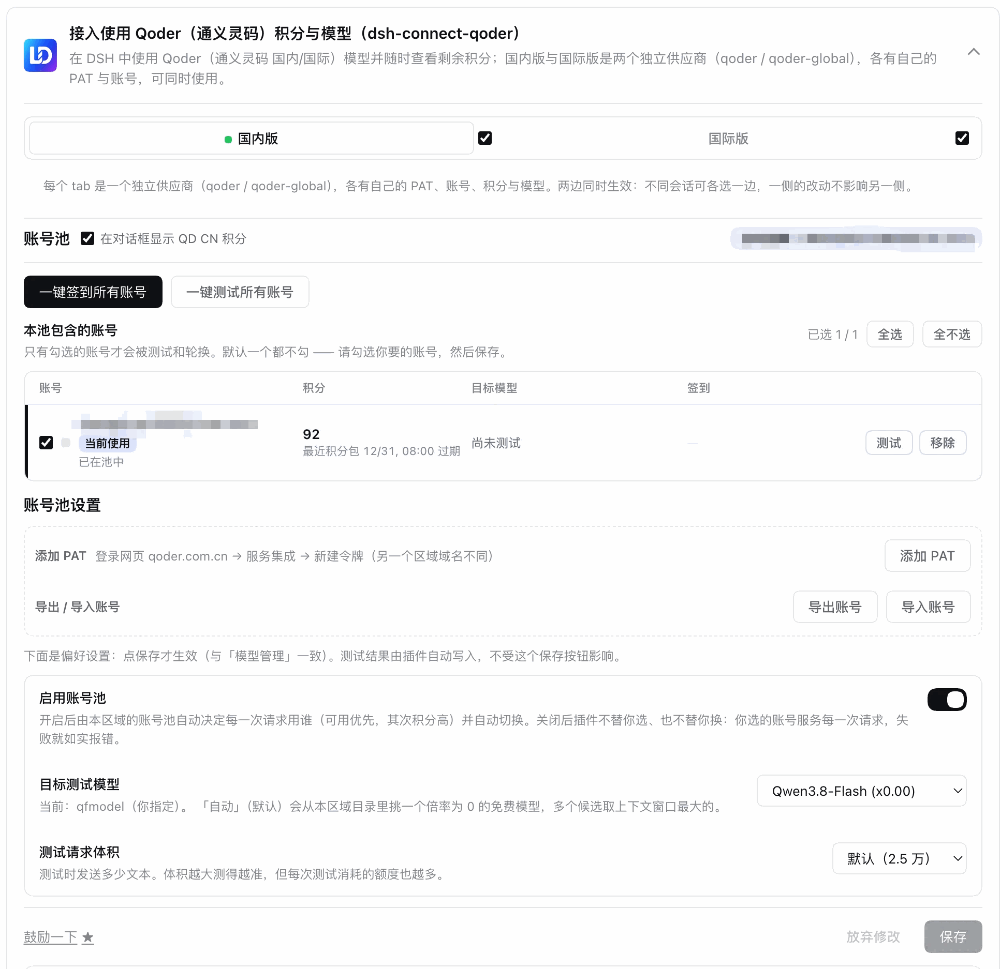
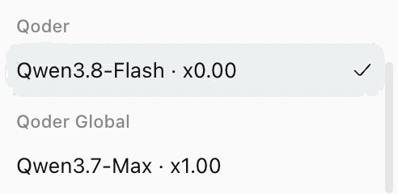
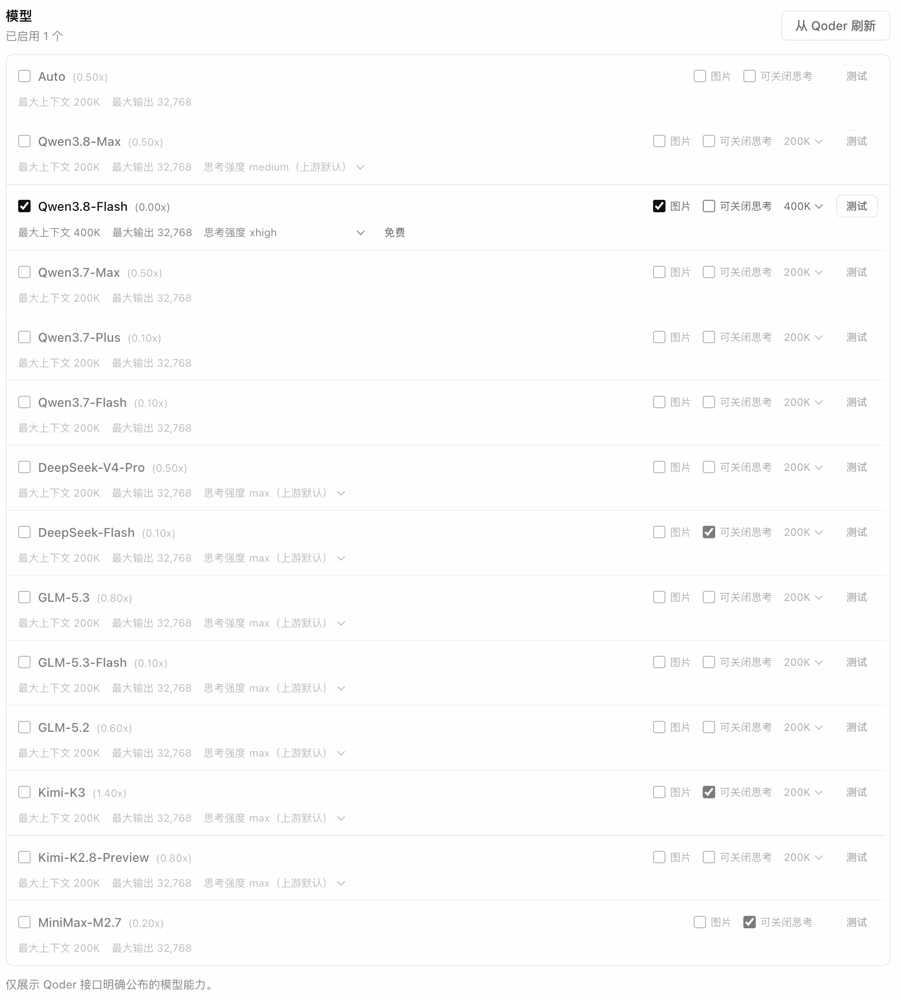
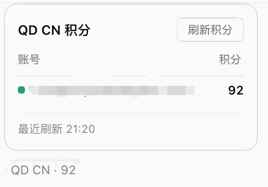

<p align="center">
  
</p>

<h1 align="center">dsh-connect-qoder</h1>

<p align="center"><b>把 Qoder（通义灵码国际 / 国内）的模型接入 DeepSeek Harness，并提供账号池、每日签到、积分读数与模型管理。</b></p>

<p align="center">
  <a href="README.en.md">English</a> ·
  <a href="#安装">安装</a> ·
  <a href="#工作原理">工作原理</a> ·
  <a href="#配置">配置</a> ·
  <a href="#账号池">账号池</a> ·
  <a href="CHANGELOG.md">更新日志</a> ·
  <a href="https://github.com/dingminhua/dsh-connect-qoder/issues">问题反馈</a>
</p>

<p align="center">
  <a href="https://www.npmjs.com/package/%40dmh2002%2Fdsh-connect-qoder"></a>
  <a href="https://www.npmjs.com/package/%40dmh2002%2Fdsh-connect-qoder"></a>
  <a href="https://github.com/dingminhua/dsh-connect-qoder/actions/workflows/ci.yml"></a>
  <a href="LICENSE"></a>
  <a href="https://github.com/dingminhua/dsh-connect-qoder/stargazers"></a>
</p>

一个独立的 [DeepSeek Harness (DSH)](https://github.com/deepseek-ai/deepseek-harness) bundle 插件。它把 Qoder 账号的模型接到 DSH 的模型选择器，同时提供模型管理与只读的用量概览。**国内版与国际版是两个并行的供应商（`qoder` / `qoder-global`），可同时使用**；插件设置卡片以 tab 区分两者，方便统一管理。

> Qoder 官方不提供 OpenAI 兼容端点（其官方 SDK 只是 agent 启动器），因此本插件直连 Qoder 的 cosy 网关，实现了协议的最小客户端，无需在 Qoder 桌面端登录——只需一个 PAT（Personal Access Token）。

## 功能特性

- **双供应商并行接入（国内版 + 国际版）** —— 国内版注册为 `qoder` provider（`gateway.qoder.com.cn`），国际版注册为 `qoder-global` provider（`api1.qoder.sh`）。**配置了 PAT 的区域其模型会出现在 DSH 模型选择器里**：两个区域都有 PAT 时两组同时可选，不同会话可以各选一边，互不干扰。**没有 PAT 的区域不列出任何模型**（一个请求也发不出去，列出来只会点到就失败）；配置 PAT 后「刷新模型」即可让模型自动出现——provider 本身始终注册着，因为它的设置卡片正是配置入口。模型名内嵌上游积分倍率（如 `Qwen3.8-Flash · x0.00`），与 Qoder 自身模型菜单一致。

  
- **插件卡片 tab 切换** —— 设置卡片顶部为「国内版 / 国际版」两个 tab，各含独立的 PAT、模型管理与用量概览；每个 tab 的目录、勾选与状态完全隔离。
- **可单独关闭任一版本供应商** —— 每个 tab 右侧有一个勾选框（默认都勾选）。**取消勾选即把该供应商从 DSH 模型选择器里彻底撤掉**（不是只藏起 tab）：它的路由与「设置 → 模型」页的目录条目一并摘除。PAT、用量与勾选**全部保留**，重新勾选即完整恢复。注意：若某会话此前选中的正是被关闭供应商的模型，该会话再调用会报 `NO_ADAPTER`。
- **模型管理** —— 从上游刷新完整模型目录，逐项勾选启用或禁用；模型行显示倍率（`(0.50x)`）、上下文/输出上限、思考强度档位与免费标记，行右有「图片」「可关闭思考」开关、上下文档位选择器与「测试」按钮。勾选状态写入本地配置，立即同步到模型选择器。

  
- **模型可用性测试** —— 每个模型行有一个「测试」按钮，直达上游确认该模型此刻能否使用：限流（429）报「被限流」、凭据无效报「凭据无效」、内容审核拒绝报「内容被审核拒绝」、额度耗尽报「额度已耗尽」，其余上游瞬时故障如实分类。探测在后台发起，**凭据不会传到页面**；结果不写入设置，也不改变你已保存的勾选。**它发的是真实请求**（会消耗少量上游额度），因此只能按单个模型手工点，没有「测试已勾选」这类批量按钮。
- **每日签到** —— Qoder 有官方每日签到活动（个人用户每天可领 100 Credits，30 天有效）。账号池提供「一键签到所有账号」：逐账号领取、已领过的按幂等处理（不重复领取、不算失败），签到后积分自动刷新。国内版与国际版都已接通（国际版需要本机 Qoder 客户端的设备风控组件，取不到时如实报错而不是假装「今天没有活动」）。
- **积分（只读）** —— 账号池逐账号显示剩余积分与最近积分包的到期时间（来自 Qoder 的 `sash/api/v2/me/usage`，凭 `jt-` jobToken 查询）；临期的积分包会高亮。查询是**只读**的、不消耗积分；读不到时（凭据被拒 / 上游未响应）如实说明原因并给出路，不留一片空白。
- **安全 loopback shim** —— 每区域一个随机端口 + 进程内随机 secret，真实 Qoder PAT **不交给 pi-ai**：pi-ai 只与本地 shim 对话，shim 用 cosy 会话（jobToken）做上游请求。
- **多账号池（PAT）** —— 每区域一个本地 vault `$DSH_HOME/.qoder-accounts.<region>.json`（0600），把设置 PAT、环境变量与 vault 账号三源去重合并；卡片可新增（粘贴 `pt-…`，经 `JobToken` 交换校验并取显示名，也可自填备注名）/ 改名账号，也可显式选择某一账号服务（`regions.<region>.accountId`，留空自动按 settings → env → vault 选取）。**移出池**与**删除**是两件事：移出池 = 在池表格里取消勾选并保存（凭据留着，随时勾回）；删除 = 池表格行内的「删除」按钮，二次确认后抹掉 vault 里的 PAT 并自动退出池与区域选择（不可恢复；设置/环境变量里的 PAT 不归本插件管，不提供删除按钮）。
- **按实测排序与自动换号** —— 「一键测试所有账号」对池内每个成员发真实请求（目标模型默认自动挑本区域倍率为 0 的免费模型），结果落 `$DSH_HOME/.qoder-pool.<region>.json`；开启账号池后，聊天流在首字节前按 `rankPool`（可用性 → 额度从高到低 → 到期最近 → id）选出服务账号，失败时依次换下一个可用账号重试，失败回写 `live-request` 探测。关掉开关则插件不替你选、也不替你换，失败如实报错。
- **账号转移（导入 / 导出）** —— 按区域把 vault 账号导出为传输文件，预览后按索引导入；跨区域域名（`qoder.com.cn` / `qoder.sh`）正向匹配，不匹配的记录计入 `skipped`。
- **思考强度与上下文预算** —— 上游按模型声明 `thinking_config.efforts`，卡片只列出**真实存在**的档位（Qwen 系 `low/medium/xhigh`、DeepSeek/GLM 系 `low/high/max`），选定即保存、每个请求自动带上（与 Qoder 客户端同一发送字段，双写顶层与 `parameters`）；上下文档位同样只来自上游 `context_config` 声明的档位，未声明时不渲染控件、不编造选项。
- **诚实的模型能力** —— 上游的 `is_vl` 是**平台**的图片输入声明而非模型原生能力（内置目录里几乎全是 `true`，连纯文本模型也是）。图片输入按**精确 model id** 的人工核对表只对文档确认多模态的模型预勾选，未核实的一律不勾，并在开关 tooltip 里说明「为什么没勾」；「关闭思考」同样只对上游显式声明、且不在已知拒绝集里的模型提供。宁可少给一个选项，也不要让用户按下去就失败。
- **composer 积分读数** —— 会话输入区（`conversation.input.left`）按区域显示 `QD CN` / `QD AI` 与当前账号余额（如 `QD CN · 92`），点开是逐账号的余额表，点某一行即切换到该账号；受每区域「在对话框显示积分」开关控制（默认开，opt-out）。

  
- **命令行诊断与现场验证** —— `dsh-connect-qoder doctor|status|logout [--json] [--region cn|global]`：`doctor` 报 PAT 来源、cosy 指纹派生、pi-ai 代际、宿主心跳存活与 vault 账号计数；`status` 报凭据来源、上游可达性与当前剩余积分；`logout` 清除指定区域的 vault 账号与账号池测量副本。另有 `pnpm run probe:cosy`（不依赖宿主直连 cosy 链路验证）与 `pnpm run probe:vault`（只读 dump vault / 账号池测量，PAT 只显示掩码）。

## 工作原理

```text
DSH PiAiAdapter（每个 provider 一套）
  -> 安全 loopback shim（每区域一个随机端口 + 进程内随机 secret）
  -> QoderUpstreamClient（cosy 协议最小客户端）
  -> 国内版 https://gateway.qoder.com.cn/algo/api/v2/...
  -> 国际版 https://api1.qoder.sh/algo/api/v2/...
  -> Qoder SSE（OpenAI 形状增量）
  -> DSH 本地执行工具并回传结果
```

国内版与国际版各持一套完整的运行时栈——上游客户端、模型 catalog、回环 shim、adapter——按区域配置（网关 / openapi / 目录路径）隔离，所以**两个区域的模型可以同时可选、被不同会话使用**。

凭据是 PAT（设置卡片 `regions.<region>.pat` 或环境变量，见[配置](#配置)），设置项优先。每次会话按需惰性交换 **jobToken**：PAT 只在这个交换请求里使用一次，之后的对外请求全部携带 cosy bearer（自定义 Base64 载荷 + MD5 签名）与「机器指纹」会话头。**PAT 从不进入 pi-ai，也从不外发到网关之外；本插件不读不写 Qoder 桌面端的本地登录文件。**

模型的 cosy 编码与签名细节（自定义字母表、`n/3` 重排、`cosy&<SECRET>&<date>` 签名、RSA/AES 会话封装）见 `src/cosy.ts` 的头部注释；错误分类（内容审核 / 限流 / 额度耗尽 / 瞬时故障）与 DSH 重试语义的对应见 `src/upstream.ts`。

## 安装

### 从发布包安装（推荐）

```bash
dsh plugin --profile desktop add @dmh2002/dsh-connect-qoder   # Desktop
dsh plugin --profile web add @dmh2002/dsh-connect-qoder       # Web
```

装完**重启该 profile 的 DSH 进程**（bundle 的 host 半边在启动时加载）。也可以在 DSH 的「插件市场 / Bundles」里搜 `dsh-connect-qoder` 一键安装。

> npm 包名带 `@dmh2002/` 作用域，但插件在 DSH 内的**标识不带作用域**：设置命名空间、`/plugins/dsh-connect-qoder/…` 路由与命令行程序名都仍是 `dsh-connect-qoder`。所以 0.2.0 之前装过的用户升级后配置照旧生效，不用重填 PAT。

### 从源码构建（开发）

```bash
git clone https://github.com/dingminhua/dsh-connect-qoder.git
cd dsh-connect-qoder
pnpm install
pnpm run check        # typecheck + test + build 全绿后再安装
```

以 `link:` 安装进当前 profile，改码后重启 DSH 即生效（不会重装依赖树）：

```bash
dsh plugin --profile desktop add /Users/dmh2002/DshProject/dsh-connect-qoder
```

### 验证安装

- 打开「设置 → 插件」应能看到 dsh-connect-qoder 的配置卡片（国内版 / 国际版两个 tab）。
- 在该 profile 目录里 `pnpm exec dsh-connect-qoder doctor` 应输出两个区域的 PAT 状态与指纹派生。
- 配置 PAT 后，「从 Qoder 刷新」应拉出该区域的真实模型清单；模型选择器出现 `Qoder` / `Qoder Global` 两个分组。

## 配置

### PAT（Personal Access Token）

在 Qoder 账户设置里创建 PAT（`pt-…` 开头）。两种提供方式，**设置卡片优先于环境变量**：

| 区域 | 发证入口 | 设置项 | 环境变量 |
| --- | --- | --- | --- |
| 国内版（qoder.com.cn） | 控制台 → 设置 → API 令牌 | 卡片「国内版」tab → 添加 PAT | `QODERCN_PERSONAL_ACCESS_TOKEN` |
| 国际版（qoder.sh） | 控制台 → Settings → Personal Access Tokens | 卡片「国际版」tab → 添加 PAT | `QODER_PERSONAL_ACCESS_TOKEN` |

- PAT 只保存到本地插件配置（`regions.<region>.pat`），从不上传、不进入任何网络请求。
- 未配置 PAT 的区域不列出任何模型；`doctor` 命令会指出哪个区域缺 PAT。
- **逐步操作说明见 [`docs/PAT.md`](docs/PAT.md)**（含创建流程、验证机制、优先级与常见问题）。

### 区域启停

卡片每个 tab 右侧的勾选框控制该区域是否参与模型选择（opt-out：**显式取消勾选才停用**）。停用只摘除路由与目录条目，配置全部保留。

### 多账号池与凭据来源

除设置 PAT 与环境变量外，每区域还有一个本地 vault（`$DSH_HOME/.qoder-accounts.<region>.json`，权限 0600）保存多个 PAT 账号。三源按 **settings → env → vault** 的优先级去重合并（同一个 PAT 只在最高优先级的来源里列出一次）。

- 卡片可新增（粘贴 `pt-…`，经 `JobToken` 交换校验并取回显示名，也可自填备注名）/ 改名 vault 账号，也可显式选择某一账号服务（`regions.<region>.accountId`，留空自动）。删除 vault 账号在池表格的行内「删除」按钮（需二次确认）；取消勾选并保存只是把它移出轮换，PAT 仍留在本地。
- 选中的凭据只用于会话的 jobToken 交换与后续 cosy 请求，从不进入 pi-ai 或页面。
- `logout [--region cn|global]` 会清除指定区域的 vault 账号与账号池测量副本（`$DSH_HOME/.qoder-accounts.<region>.json` 与 `.qoder-pool.<region>.json`）。
- 勾选成员、一键签到、一键测试与自动换号的规则见[账号池](#账号池)。

## 账号池

一台机器上往往有多个 Qoder 账号（多个 PAT）。**账号池**把这些账号收成一次点击：勾进池子，然后「一键签到所有账号」或「一键测试所有账号」；再打开**启用账号池**，插件就会在请求失败时自动换号接着跑。

**每个区域（国内版 / 国际版）各有独立的一池**：成员、目标模型、积分与签到状态互不影响——两边的账号本来就属于不同的供应商。**两个区域都有每日签到**：国际版的签到活动只下发给带设备风控头的请求，插件按区域读取本机 Qoder 客户端自带的设备身份组件；取不到时如实报错，不会把「拿不到设备身份」伪装成「今天没有活动」。

### 自动换号（开启账号池即生效）

- **谁来服务由排序决定**：开启后**每一次请求**都发给池内排序最靠前的可用账号，所以「当前使用」显示的是排序的结果，不一定是你手动选的那个。
- **失败时继续往下试**：某个请求在上游失败时，插件**依次**用池内其他可用账号重试，直到有一个接手、或全部不可用为止才把错误报出来。
- **哪些失败会换号**：429 限流、额度耗尽、401/403 凭据被拒、5xx 网关与网络故障——这些都是**某个账号**的状态，换一个很可能就过了。
- **哪些不会**：请求本身不合法（HTTP 400）——同一个请求体换谁都是同样的 400，重试只是让你多等几轮；**流已开始之后**也不会重放（字节已经发出去了）。
- **已知不可用的账号会被跳过**：处于限流冷却期内、或凭据已被上游拒绝的成员不参与选择。**从没测过的账号按「默认可用」参与**——刚添加的账号不该因为「还没测」就被排除。
- **手动选择从不被改写**：池子通过运行时覆盖决定「谁服务」，**不写回你保存的选择**；关掉开关，你选定的账号立刻完全生效。
- **失败会被记下来**：一次失败会写成该账号的测量（含上游报文中给出的恢复时间），下一个请求直接从可用账号开始，不必每次先撞一遍同一个限流账号。

### 这个开关到底控制什么

**它只控制「插件要不要自己决定」，不控制「你能不能操作」。**

| | 账号池 **开启** | 账号池 **关闭** |
| --- | --- | --- |
| 谁服务 | 由排序**自动**选出（可用优先 → 积分高 → 积分包快过期 → id） | **你**在账号行里手动指定 |
| 请求失败 | **自动**换下一个可用账号重试 | 不换号，如实报错 |
| 一键签到 / 一键测试 | 可用 | **仍然可用** |
| 目标测试模型 | 可改 | **仍然可改** |

最后两行是刻意的：签到与测试是**手动动作**，作用于你勾选的成员，与「插件是否自动路由」是两件事。

**唯一的硬约束**：池里一个成员都没勾选时，批量动作一律拒绝。空的池**绝不**退化成「那就对全部账号执行」——那是唯一会花掉你没授权过的积分的解读。

### 排序规则（开启账号池后决定谁服务）

1. **可用优先** —— 被测量判定为不可用（限流未到恢复时间、凭据被拒等）的排到最后；
2. **积分高者优先** —— 只在有**新鲜读数**时参与（卡片轮询、批量测试或保存时读到的那份，10 分钟内有效）：请求路径**不会**为了排序去打上游，否则一页对话就变成 N 个额外请求；
3. **快过期的积分包优先** —— 3 天内到期的先花，过期即作废；
4. 最后按账号 id 收尾，保证顺序是**全序**、可复现。

### 两个批量动作

- **一键签到所有账号** —— 逐个账号领取当日的官方签到活动。**先查状态再领取**，已领过的直接标「已签到」而**不发写入请求**（幂等，不重复领取）；任何单个账号失败只标记该行，**不中断整批**。签到会改变余额，因此批次结束后作废该区域的积分缓存，卡片不会继续显示领取前的数字。
- **一键测试所有账号** —— 对每个成员发一次真实请求，得出「这个账号此刻能不能用这个模型」。目标模型默认由「自动」挑本区域**倍率为 0 的免费模型**（多个候选取上下文窗口最大的），你也可以显式指定——但**在免费模型出现之前测试保持关闭**，避免在你不知情的情况下花掉积分。测试走的是与模型行同一套探测，因此**有真实成本**。

不提供**自动**签到：签到会真实领取奖励，只在你点按钮时执行。

## 命令行诊断

在**已装本插件的 profile 目录里**跑（推荐，无需全局安装）：

```bash
cd ~/.dsh/profiles/desktop
pnpm exec dsh-connect-qoder doctor    # PAT 来源 + cosy 指纹派生 + pi-ai 代际 + 心跳 + vault 计数（纯本地，不发请求）
pnpm exec dsh-connect-qoder status    # 每区域凭据来源 + 上游模型目录可达性 + 剩余积分（需 PAT）
pnpm exec dsh-connect-qoder logout --region cn   # 清除指定区域的 vault 账号与账号池测量副本
pnpm exec dsh-connect-qoder doctor --json        # 机器可读输出
```

`status` 会真实交换一次 jobToken 并拉取模型目录（随后只读查询一次用量），因此需要对应区域的环境变量或 vault PAT；`doctor` 完全离线。

> **两条实测过的注意事项**：
> 1. **别用 `node node_modules/dsh-connect-qoder/lib/bin.js` 这种裸路径**——0.3.0 起包名带作用域，软链在 `node_modules/@dmh2002/dsh-connect-qoder`，写旧路径只会得到 `MODULE_NOT_FOUND`（缺的是**入口文件**，不是 peer）。
> 2. CLI 依赖宿主提供的 peer 包（`@deepseek-ai/dsh-atomic-write` / `dsh-home-paths`）。本机实测：pnpm 会随包把它们装进 profile 的依赖树，`pnpm exec` 与 npm 装的 tarball 都能跑通。但这**取决于 pnpm 版本与 `auto-install-peers` 配置**——如果在你机器上报 `Cannot find package '@deepseek-ai/dsh-atomic-write'`，那是这一层没装上；设置卡片与 provider **不受影响**（它们在宿主进程内，宿主自己解析这些名字）。同族 workbuddy 的 issue #47 是同一个形状，其修复方案（宿主优先、按需回落自带实现）适用于本项目，尚未移植。

## 平台支持

| 平台 | 状态 |
| --- | --- |
| macOS | ✅ 已验证（开发与 CI） |
| Windows | ✅ CI 测试通过（上游请求走标准 fetch，无平台专属路径） |
| Linux | ✅ CI 测试通过 |

## 受支持的宿主范围

| 宿主 | peer 范围 |
| --- | --- |
| DSH（`@deepseek-ai/*`） | `>=0.1.7-rc.1 <0.2.0-0 \|\| >=0.2.0-rc.1 <0.3.0-0` |
| Node.js | `^22.19.0 \|\| >=24.0.0` |

> 范围由 `tests/dsh-line.spec.ts` 强制，且**必须写成两条分支**：DSH 至今只发预发布，而 node-semver 只有当范围里*某个*比较符与该版本的 `major.minor.patch` 元组完全一致、且自身也带预发布标签时，才会放行预发布版本。只写 `>=0.1.7-rc.1 <0.3.0-0` 会**静默排除整条 `0.2.0-rc.*` 线**——而 `0.2.0-rc.2` 正是 `@deepseek-ai/dsh` 当前的 `latest`，用户装到就会 `ERESOLVE`。上界仍须带 `-0`（`<0.3.0` 不挡任何东西）。

## 安全说明

- PAT 只写入本地插件配置（或环境变量），**从不进入任何网络请求**；对外请求一律使用 cosy 会话令牌（jobToken）+ 机器指纹头。
- 本地 shim 用随机端口的 loopback 服务 + 进程内 secret 鉴权，并校验 Host / Origin / Content-Type，请求体有 64MB 上限。
- 本插件只读你显式提供的 PAT；**不读取、不修改** Qoder 桌面端的本地登录/凭据文件。
- 诊断输出（`doctor` / `status` 与卡片探测）均脱敏，不打印任何令牌样式的字符串。

## 市场收录与展示

本插件声明了可安装的 `dsh.bundle` manifest（`dsh.bundle.patch: ./cordis.patch.yml`），因此可以用 `dsh plugin add` 安装。社区市场通常从 [Awesome DSH Plugin](https://github.com/awesome-dsh-plugin/awesome-dsh-plugin) 注册表同步条目；仓库内的提交草稿位于 [`awesome-dsh-plugin-submission/dingminhua__dsh-connect-qoder.yml`](awesome-dsh-plugin-submission/dingminhua__dsh-connect-qoder.yml)。

**收录目录规范**（依据 [contributing.md](https://github.com/awesome-dsh-plugin/awesome-dsh-plugin/blob/main/contributing.md)）：

- 每个插件一个 YAML：`data/plugins/<owner>__<repo>.yml`，字段为 `url`（与仓库地址完全一致）、`name`（`owner/repo`）、`category`（有效值之一，本项目为 `model`）、`description.en`（必填，以句号结尾）/ `description.zh`（可选）；描述中含 `: ` 必须加引号。
- 仓库需声明 `dsh.bundle` manifest、被 `dsh-plugin` topic 标记、创建满 1 天且处于活跃维护；描述必须属实、不带营销词——它会被逐条对照代码核对。
- 注册表的两个 README 由脚本生成，不得手工编辑；修改 YAML 后在其仓库执行 `npm ci` + `node scripts/generate-readme.mjs` 重新生成。
- 一个 PR 最多收录 3 条；只改自己的条目。

市场卡片中的截图与 GitHub README 徽章是两套机制：

- **市场截图**按当前约定由**插件自己仓库根目录的 `screenshots.json`** 声明（本项目声明了 [screenshots.json](screenshots.json)）；注册表的 `data/screenshots.json` 是旧约定下的回退，**不再添加新键**。
- **GitHub 徽章**由本 README 顶部的 Shields 图片链接生成；**市场图标/占位图**由具体市场的展示规则决定，不是 npm 字段，也不是 README 徽章。

## 已知限制

- 依赖 Qoder 的 cosy 网关与 `sash` 接口（**非官方开放 API**），上游变动后插件可能需要随之调整。协议行为参照 [Zhengyuuuui/qoder2api](https://github.com/Zhengyuuuui/qoder2api)，本项目独立实现，不复制其源码。
- **每日签到**是 Qoder 面向**个人用户**的运营活动（企业版账号不参与），规则与额度以官方为准；国际版的签到活动要求请求带本机 Qoder 客户端的设备身份，因此**未安装 Qoder 客户端的机器上国际版签到不可用**（插件如实报错，不静默降级）。
- 图片输入与「可关闭思考」按**已核实**的清单给出：上游没有明确公布的能力一律不预勾选，因此某些其实可用的模型可能需要你手动勾一次。
- 模型可用性测试与批量测试**都会发出真实请求**，会消耗少量上游额度；没有「测试已勾选」这类批量按钮，批量动作只作用于你显式勾选进池的账号。
- **独立 CLI 依赖宿主提供的 peer 包**（`@deepseek-ai/dsh-atomic-write` / `dsh-home-paths`）。本机实测：pnpm 会随包把它们装进 profile 的依赖树，`pnpm exec dsh-connect-qoder …` 与 npm 装的 tarball 都跑得通；但这取决于 pnpm 版本与 `auto-install-peers` 配置，若报 `Cannot find package '@deepseek-ai/dsh-atomic-write'` 就是这一层没装上。provider 注册、设置卡片与对话**都不受影响**（它们在宿主进程内，宿主负责解析这些名字）。同族 workbuddy 的修复方案（宿主优先、按需回落自带实现）适用于本项目，尚未移植。

## 免责声明

- 本项目**仅供个人学习和研究使用**，仅驱动使用者自己的 Qoder 账号在本机调用，请勿用于商业用途或超出个人合理使用的场景。
- 使用者需遵守 Qoder / 通义灵码的服务条款；因使用本项目产生的任何后果（包括但不限于账号被限制、额度被清空、服务中断），由使用者自行承担。
- 本项目作者不对任何因使用或滥用本项目产生的直接或间接损失负责。
- 本项目与阿里巴巴、通义灵码、Qoder、DeepSeek 均无关联，未获其授权或认可；文中出现的名称仅用于描述兼容关系，其商标权利归各自所有。

## 致谢

本项目建立在他人已公开的工作之上，详见 [THIRD_PARTY_NOTICES.md](THIRD_PARTY_NOTICES.md)：

- [**Zhengyuuuui/qoder2api**](https://github.com/Zhengyuuuui/qoder2api)：cosy 协议 wire behavior 的参照实现（编码、签名、会话、指纹、jobToken、SSE 形状、错误分类）。本项目按其行为**独立实现**为 TypeScript，不复制其源码；该仓库未附独立 LICENSE，其 README 声明源自 `wangtufly/QCCG`（GPL-3.0）。
- [**L0NE-6/Qoder-Daily**](https://github.com/L0NE-6/Qoder-Daily)（MIT）：每日签到的协议参照（`campaigns` / `claim` 形状、幂等判定、国际版设备风控思路）。本项目按其文档与本机实测行为独立实现，不复制其源码。
- [**dingminhua/dsh-connect-workbuddy**](https://github.com/dingminhua/dsh-connect-workbuddy)（MIT）：插件工程结构、卡片交互模型、loopback shim 模式与 npm 发布工程的基准。
- [**dingminhua/dsh-connect-trae**](https://github.com/dingminhua/dsh-connect-trae)（MIT）：经 workbuddy 转引的卡片外观与发布工程基准。
- [**franksong2702/dsh-codex-connect**](https://github.com/franksong2702/dsh-codex-connect)（Apache-2.0）：经 workbuddy 转引的 DSH 插件结构与 pi-ai provider 注册参照。
- Qoder 官方 SDK 的类型定义：仅用于 usage/头的形状核对，不随本项目分发。

## License

MIT © LaoDing —— 详见 [LICENSE](LICENSE)。